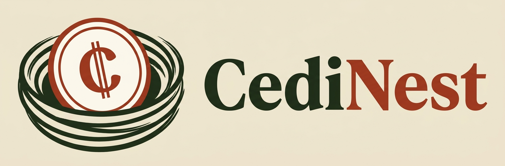
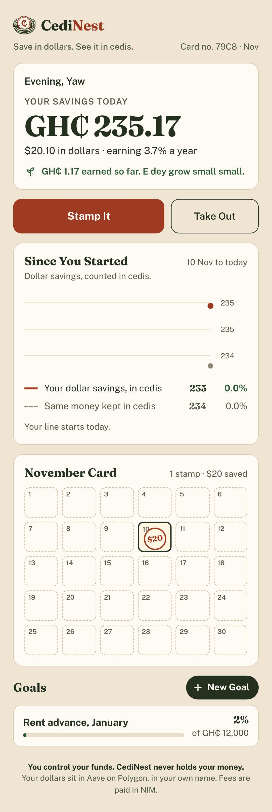
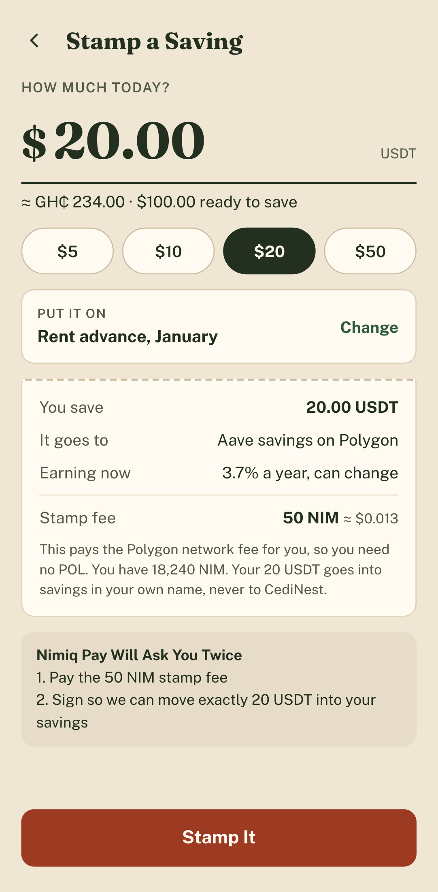
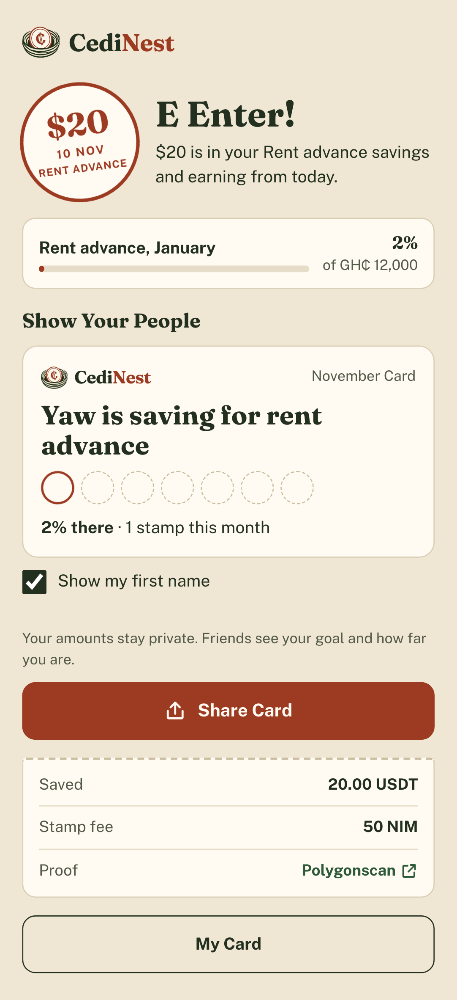

<p></p>

# CediNest

**Save in dollars. See it in cedis.**

CediNest is a [Nimiq Pay](https://nimiq.com/nimiq-pay) mini app for Ghana. You move USDT into
[Aave v3](https://aave.com) on Polygon, where it earns a variable rate, and CediNest shows every
balance, goal and gain in Ghana cedis. Set a goal like next year's rent advance, stamp a saving whenever you
can, and watch a monthly stamp card fill up, the way a susu collector's card does.

**You control your funds. CediNest never holds your money.**

<p>
  
  
  
</p>

Entry for the Nimiq Mini Apps Competition, Cycle III, **Earn** category.

| | |
| --- | --- |
| Production | https://cedinest.vercel.app |
| Open in Nimiq Pay | https://nimpay.app/miniapps/open/cedinest.vercel.app |
| In-app scheme | `nimiqpay://miniapp?url=cedinest.vercel.app` |
| Until it is listed | Nimiq Pay › Mini Apps › Custom URL › `https://cedinest.vercel.app` |
| Health and configuration | https://cedinest.vercel.app/api/health |

## How a save works

Most Nimiq Pay users hold NIM and USDT, not POL, and a mini app cannot sponsor Polygon gas. So the
user pays a small fee in NIM (about 50 NIM, around one US cent) and a relayer pays the gas.

1. On open, the app calls the Nimiq Pay SDK for the NIM account and the injected EIP-1193 provider
   for the Polygon account, switches to chain `0x89`, and loads the summary.
2. The user picks an amount and a goal. The app calls `POST /api/quote`.
3. The API prices the fee from live gas, POL and NIM prices (50 NIM floor), stores a quote that
   expires in 10 minutes and returns the fee, the memo and the permit fields.
4. **Approval 1:** the app pays the NIM fee with the memo `cedinest:<quoteId>` through
   `sendBasicTransactionWithData`.
5. **Approval 2:** the app builds the USDT0 EIP-2612 permit, asks Nimiq Pay for
   `eth_signTypedData_v4`, and checks locally that the recovered signer is the user.
6. The app calls `POST /api/jobs`. The API checks the quote, recovers the signer, dry-runs
   `depositFor` and answers `202 {jobId}` at once.
7. After the response (`waitUntil`), the API waits for the NIM payment to be final (memo, amount,
   recipient, execution result, macro-block rule), sends `depositFor` from the relayer wallet under a
   Postgres advisory lock, and waits for the receipt.
8. The app polls `GET /api/jobs/:id` every 2 s and moves from "Stamping" to "E Enter!". The user
   can close the app; the job finishes server-side.

Withdrawals are the same flow with a permit on aPolUSDT and `withdrawFor`. "Take out everything"
signs `value = 2^256 - 1` and the contract pulls the current aPolUSDT balance.

Job states: `fee_pending → fee_final → submitted → done`, or `failed` (bad fee payment, nothing moved)
or `refund_due` (fee paid, relay failed or the user cancelled the signature; the NIM is refunded
manually within 24 hours and the daily cron lists these jobs).

## The relay contract

[`contracts/contracts/CediNestRelay.sol`](contracts/contracts/CediNestRelay.sol) is about 70 lines,
holds nothing between transactions, and can only move a user's money between their wallet and their
own Aave position.

| Network | Address |
| --- | --- |
| Polygon mainnet | [`0xA46C2c8e3Fd4A1c6D6c4ae81f5ACC4d32E37f4E4`](https://polygonscan.com/address/0xA46C2c8e3Fd4A1c6D6c4ae81f5ACC4d32E37f4E4) |

**Security notes**

- The relayer can call exactly two functions, `depositFor` and `withdrawFor`, and both send the
  result to the signer (`supply(onBehalfOf = owner)`, `withdraw(to = owner)`).
- A stolen relayer key can at worst move a user's savings between their own Aave position and their
  own wallet, and only with a valid permit from that user. It cannot take them.
- No admin withdraw, no upgrade, no fee taken in USDT. The owner can only rotate the relayer.
- A permit that someone front-runs still works: the contract falls back to the allowance.
- aToken transfers can leave 1 unit (0.000001 USDT) of rounding dust. That is expected.

Fork tests against live Polygon cover the happy paths, withdraw-all with 30 days of interest,
`NotRelayer`, front-run permits, bad and expired and reused signatures, and relayer rotation.
Measured gas on a fork: `depositFor` 237,328, `withdrawFor` 289,509 (the fee formula uses these
times 1.2 with a 1.5 margin, which the 50 NIM floor covers about 2.5 times over at today's gas).

## The USDT0 permit domain, and why it matters

USDT on Polygon is USDT0 since the August 2025 in-place upgrade (`name()` and `symbol()` return
"USDT0"; the app still shows "USDT"). Its EIP-2612 domain is **non-standard**: name `USDT0`,
version `1`, `verifyingContract` = the token, and a `salt` of chain id 137 as bytes32, with **no
`chainId` field**. Field order is name, version, verifyingContract, salt. Sign it with the standard
domain and the recovered signer is wrong. aPolUSDT uses the standard domain (name
`Aave Polygon USDT`, version `1`, chainId 137). Both are in [`shared/constants.ts`](shared/constants.ts)
and checked against `DOMAIN_SEPARATOR()` on mainnet by `contracts/scripts/check-domains.ts`.

## Repo layout

```
index.html, src/          Vite + Vue 3 app (views, components, copy/en.ts holds every string)
api/                      Vercel Functions: quote, jobs, summary, goals, session, profile, cron
shared/                   constants, fees, APY, typed data, Nimiq verifier, chart maths
contracts/                Hardhat 2 project: CediNestRelay.sol, fork tests, deploy script
db/schema.sql             Neon Postgres schema
scripts/                  local API server, migrations, NIM payment verifier, copy check
tests/                    Vitest unit + API tests, Playwright end-to-end tests
```

## Running locally

```sh
npm install
npm run dev:mock      # fake Nimiq Pay + Polygon wallet in the browser, fake chains, in-memory Postgres
```

Open http://localhost:5173. `dev:mock` sets `CHAIN_MODE=mock` for the API (fake Polygon and Nimiq,
PGlite database) and `VITE_MOCK_WALLET=1` for the app (a throwaway signer that never holds funds).
Signature recovery, quotes, jobs, goals and sessions all run for real against the fake chains.

For the real thing on a phone: `npm run dev -- --host`, phone on the same Wi-Fi, load the LAN URL
as a local mini app (nimiq.dev › Load a Local Mini App), with the server env below in `.env`.

```sh
npm test              # Vitest: fee maths, typed data, Nimiq verifier, chart maths, API flows, copy rules
npm run test:e2e      # Playwright: welcome → goal → save → done → share → take out, plus error states
npm run typecheck
npm run build && npm run copy:check
cd contracts && npm install && npm test   # fork tests against live Polygon
```

## Environment variables

See [`.env.example`](.env.example). Server (Vercel): `DATABASE_URL`, `RELAYER_PRIVATE_KEY` (sensitive),
`RELAY_ADDRESS`, `NIM_FEE_ADDRESS`, `SESSION_SECRET`, `CRON_SECRET`, optional `POLYGON_RPC_URL` and
`NIMIQ_RPC_URL`. App: `VITE_RELAY_ADDRESS`. `CHAIN_MODE=mock` and `VITE_MOCK_WALLET=1` are for local
dev and tests only.

Going live, in order: deploy the contract (`contracts/`, relayer = a fresh EOA, owner = a cold
address), verify on Polygonscan, fund the relayer with POL, create the NIM fee address in the Nimiq
Wallet, set the env vars on Vercel, run `npm run db:migrate` against Neon, then do a 1 USDT save and
a full withdrawal from a phone. `GET /api/health` lists any missing configuration.

## Feasibility checks

Three things were checked before the app was written. `/lab` (built only with `VITE_ENABLE_LAB=1`)
signs the USDT0 and aPolUSDT permits on a real phone and pays 10 NIM with a memo;
`scripts/verify-nim-payment.ts` verifies that payment against the Nimiq RPC; and the Hardhat fork
tests prove the salt-domain permit lets a second account supply to Aave on the user's behalf.

## Licence

MIT. See [LICENSE](LICENSE).
